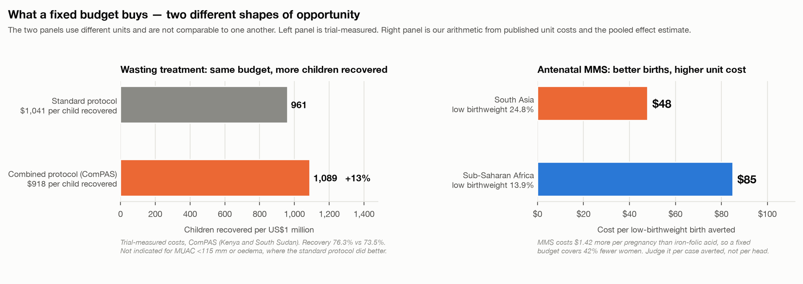

# The decision

The Impact Alliance narrowed fifteen nutrition interventions to three: **community-based
management of acute malnutrition (CMAM)**, **breastfeeding and newborn care**, and
**antenatal multiple micronutrient supplementation (MMS)**. All three are established. The
question this memo answers is not which is best — they do different jobs in different
populations, and a single ranking would mislead. It is the harder question: **which change is
small enough for a ministry to make, and big enough to be worth making?**

Answered that way, the three stop looking alike. Their evidence is comparable in quality. Their
**economics are not**, and that is what determines whether a government can act.

## Three shapes of opportunity

|  | The change | What a fixed budget does | The catch |
|---|---|---|---|
| **CMAM → simplified protocol** | Change the dosing protocol; keep the service | **Recovers ~13% more children for the same money** | Not for the most severe cases |
| **IFA → MMS** | Swap one tablet for another in existing antenatal care | Covers **42% fewer** pregnancies — unit cost rises | WHO has not endorsed routine use |
| **Kangaroo care → start immediately** | Change the ward protocol; no commodity at all | Budget barely moves; **cost-saving in operation** | Needs facility delivery and staffing |

{width=6.5in}

Only the first is an efficiency gain. The second buys a better outcome at a higher unit price.
The third is almost free but bounded by where births happen. **These call for three different
conversations with a finance ministry, not one.**

---

# 1. Wasting treatment: do more with the same money

**The problem.** Roughly **one severely wasted child in three** receives treatment, leaving
about **8 million children a year** untreated. Of those who are treated, between **22% and
63% relapse within six months**, depending on setting. Severely wasted children die at roughly
**11.6 times** the rate of children with normal weight-for-height.

**What works.** Outpatient treatment with ready-to-use therapeutic food (RUTF) works, and we
know how to deliver it. The newer finding is that **simplified protocols hold recovery while
using far less therapeutic food**. In a 2025 three-arm trial in Niger, the combined SAM/MAM
protocol (ComPAS, 50% less food) met non-inferiority on both intention-to-treat and
per-protocol analysis; a tapered-dose protocol (OptiMA, 32% less) met it on
intention-to-treat only.

Therapeutic food is the largest single line item — 43% of institutional cost where it was
measured. The ComPAS trial costed the result directly, in Kenya and South Sudan:

| | Cost per child recovered | Children recovered per $1M |
|---|---|---|
| Standard protocol | $1,041 | 961 |
| Combined protocol (ComPAS) | **$918** | **1,089 — +13%** |

The combined protocol used 122 sachets per child recovered against 193, and recovered 76.3% of
children against 73.5%. *These are trial-measured costs, not modelled. A simple model of the
commodity saving alone gives a larger figure — around 28% — which the trial data do not support,
because non-commodity costs do not fall proportionally.*

**What does not work.** **Screening without a treatment pathway.** In Mali, a trial raised
screening coverage by 40 percentage points and changed treatment coverage not at all — 7.6% of
acutely malnourished children received appropriate treatment, in both arms alike, because
volunteers gave identified children preventive supplements instead of referring them. In
Burundi, community mass screening enrolled 8% of the cases it found, against 98% for
clinic-based screening, because a child found in a village still has to reach a facility.

**Decentralisation is also not automatically cheaper.** In Pakistan, adding community health
worker delivery alongside facility care cost slightly less per child *treated* but more per
child *recovered*, because recovery was lower — 76% against 83%.

**Pairing treatment with cash reduces relapse substantially.** A cluster-randomised trial in
DRC cut relapse by 70–80% (adjusted hazard ratios 0.21 to moderate and 0.30 to severe acute
malnutrition) and raised recovery by 35%. But the transfer was large — $240 per child, roughly
the cost of treatment again — and **no one has yet costed it properly**. Treat it as a
promising cost, not a saving. Transfer size appears to be the active ingredient: standard cash
transfers show no effect on wasting; double transfers do.

## From → to

| Current practice | Evidence-backed practice |
|---|---|
| Weight-based dosing for all cases | Simplified dosing for the uncomplicated caseload; standard protocol retained for MUAC <115 mm or oedema |
| Separate SAM and MAM programmes | One combined protocol, one product |
| Screening campaigns as a coverage metric | Screening and treatment coverage measured and reported as two numbers |
| Discharge and close the case | Post-discharge follow-up, with cash transfers where affordable |

**What this asks of CARE.** This is **retooling, not acquisition** — retraining frontline staff
on a simpler protocol and reconfiguring supply chains to reach community health workers rather
than stopping at the facility. The commodity saving is real and can be reinvested in coverage.

**What it asks of policy makers.** Adopting a simplified protocol means operating **ahead of
WHO guidance**, which retains weight-indexed dosing and dual discharge criteria. That is
defensible and fundable, but far better raised early than discovered late.

## Where

**India** is the single largest concentration of child wasting in the world (18.7%), in a stable
country with a functioning routine system — the question there is integration at scale. **The
Sahel, the Horn of Africa and Yemen** carry the other concentration, with Nigeria (11.6%) and
Niger (10.9%) at roughly double the sub-Saharan African average. These are two different
programmes, not one. Simplified protocols matter most where caseloads surge.

---

# 2. Antenatal MMS: pay slightly more for a better birth

**The problem.** Standard antenatal care in most low- and middle-income countries provides iron
and folic acid alone. **19.8 million babies a year are born with low birthweight** — one in
seven worldwide, one in four in South Asia — and **more than half of all newborn deaths are
attributable to babies born too small**.

**What works.** MMS outperforms iron-folic acid on **low birthweight (RR 0.88, high certainty)**
and **small-for-gestational-age (RR 0.92, moderate certainty)**. Benefit is largest in anaemic
and underweight women. The commodity change is nearly free: producing an MMS tablet costs about
half a US cent more.

**What does not work — and must not be claimed.** **MMS does not reduce mortality.** Perinatal
and neonatal mortality are both null at high certainty; maternal mortality is null and
imprecise. Presenting MMS as a mortality intervention is the single most common error made with
this evidence, and a ministry's technical advisers will catch it.

**The economics are the opposite shape to CMAM.** Procurement runs about $2.00 per pregnancy for
iron-folic acid against $3.42 for MMS, so **at a fixed budget MMS covers 42% fewer pregnancies**.
The right frame is not more-for-the-same but cost per case averted:

| | Low-birthweight births averted per 100,000 pregnancies | Cost per case averted |
|---|---|---|
| South Asia (LBW 24.8%) | ~3,000 | **~$48** |
| Sub-Saharan Africa (LBW 13.9%) | ~1,700 | ~$85 |

*Our arithmetic from published unit costs and the pooled effect estimate.* The real cost sits in
the system change — antenatal attendance, counselling, supply chain — not in the tablet.

## From → to

| Current practice | Evidence-backed practice |
|---|---|
| Iron-folic acid as default | MMS substituted in routine antenatal care |
| Commodity procured project by project | MMS on the national essential medicines list |
| Coverage counted at first ANC visit | Adherence measured across the pregnancy |

**What this asks of CARE.** Less than the others: the commodity substitutes into a channel that
already exists. The work is **advocacy and supply chain** — implementation research across four
countries found supply management "one of the most challenging aspects" in every one, with late
antenatal attendance and distance to facilities as barriers in all four. Women prefer MMS to
iron-folic acid and report fewer side effects, which is the strongest adherence asset in this
memo.

**What it asks of policy makers.** WHO recommends MMS **"in the context of rigorous research"**;
daily iron-folic acid remains the recommended standard of care. Any scale-up conversation starts
from the fact that WHO has not endorsed routine substitution. UNICEF is nonetheless accelerating
MMS introduction in seven African priority countries.

## Where

**South Asia is the cleanest match in this review** — the only case where absolute benefit
(baseline low birthweight) and relative benefit (largest in anaemic and undernourished women)
point to the same geography, on the cheapest intervention of the three.

---

# 3. Breastfeeding and newborn care: change the protocol, not the budget

**The problem.** Breastfeeding practice is far below target almost everywhere, and small and sick
newborns die at rates that immediate skin-to-skin contact demonstrably reduces.

**What works — the facility package.** **Kangaroo mother care cuts mortality by 32%** (RR 0.68,
0.53–0.86) in **preterm or low-birth-weight infants**. This is the strongest clinical result in
the entire review and carries the strongest normative backing: WHO recommends starting **as soon
as possible after birth — a strong recommendation on high-certainty evidence** — for 8 to 24
hours a day. There is **no commodity to buy**. A trial in Uganda found ward-readiness costs of
$31,000 to $114,000 per hospital, and that the practice **decreased** the cost of neonatal care
to providers and society.

**What works — the community package.** Support reduces women stopping exclusive breastfeeding at
four to six weeks (RR 0.83) and at six months (RR 0.90). At scale, Alive & Thrive raised
exclusive breastfeeding by **36 percentage points in Bangladesh and 28 in Viet Nam** — through an
NGO network in one country and government facilities in the other, which is the best available
evidence that the channel is substitutable.

**What does not work.** **"Support breastfeeding" as a message.** Cochrane's 116-trial review
found no difference by *who* delivers support — professional, peer or both — but did find that
**contact intensity matters**, with four to eight visits the tentative optimum. Design the
schedule, not the cadre.

**What must not be claimed.** The finding that community packages cut neonatal mortality by a
quarter belongs to **multi-component packages** — women's groups, home visits, birth-attendant
training — in which breastfeeding support is one element. The breastfeeding-specific share
cannot be isolated. We know how to improve breastfeeding practice; we cannot attribute a
mortality reduction to breastfeeding alone.

## From → to

| Current practice | Evidence-backed practice |
|---|---|
| Kangaroo care after the infant stabilises | Kangaroo care started as soon as possible after birth |
| Breastfeeding counselling as a general message | A defined schedule of four to eight contacts |
| Cadre debates (professional vs peer) | Package and intensity designed; cadre chosen on cost and availability |

**What this asks of CARE.** Kangaroo care is a **protocol and training change inside facilities
that already exist** — the lowest-cost change in this memo. The community package is the
opposite: it needs a defined contact schedule and the workforce to deliver it.

## Where

**South Asia** for the facility package, where low birthweight is highest and facility delivery
is rising. The community package is less geographically constrained — it follows the workforce,
not the burden.

---

# What we are asking for

1. **Pick the shape before the intervention.** If the goal is more children reached within a
   flat budget, the simplified CMAM protocol is the only one of the three that delivers it.
   If the goal is a better outcome for the same population, MMS. If the goal is a mortality
   result at almost no commodity cost, kangaroo care.
2. **Do not run options one and three on the same workforce.** Both draw on frontline health
   workers; running them together is the highest-risk configuration.
3. **Fund the measurement.** Two of the three failure modes in this memo — screening without
   treatment, and discharge without follow-up — are invisible unless both numbers are reported.

**Three data layers would sharpen a country decision** before committing: sub-national wasting
prevalence, maternal anaemia, and facility delivery coverage.

And the decisive factors are not in any literature — government appetite, current policy
windows, fragility, and the financing landscape. The evidence can say where these interventions
have the most to work with. It cannot say where they can actually be built.
